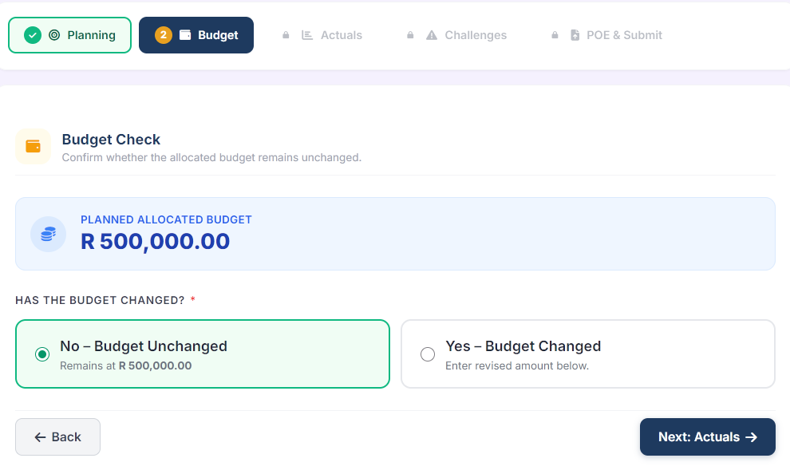

# Budget

When reporting the planning tab wil not be available for editing. Your submission will begin with the `Budget` tab

## Confirm the budget.

On the Budget tab, you will be asked if the allocated budget has changed.

{width="720"}

If not you may proceed by clicking [Next: Actuals](#confirm-the-budget){as="button"}

## Make amendments to the budget.

If the budget has changed, click [Yes - Budget Changed](#make-amendments-to-the-budget){as="button"}

{width="720"}

You must provide the following information:

1. The <shortcut>Revised Budget Amount</shortcut> in Rands.
2. The <shortcut>Reason for Budget Change</shortcut>.
3. The <shortcut>Budget Change POE</shortcut>. (All relevant documentation associated with the change.)

When done, click [Next: Actuals](#confirm-the-budget){as="button"} to proceed with submitting achievement data.
