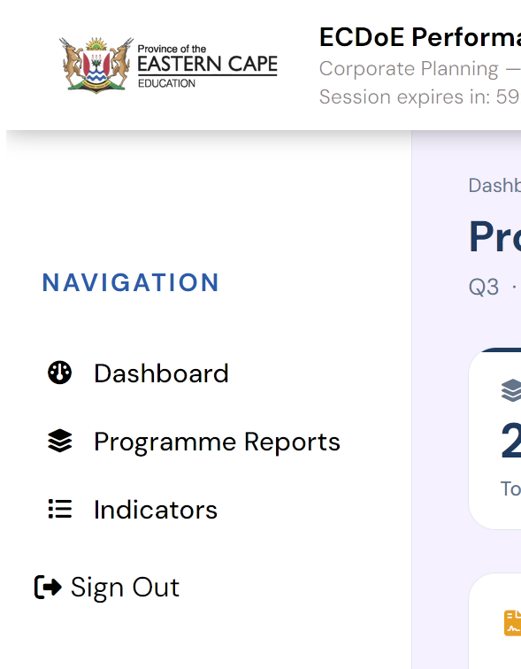

# Corporate Planning Review

In this module, users assigned the **Corporate Planning** role conduct second-level institutional reviews of both indicator submissions and Programme Overview reports.

## Review Programmes

{width="720"}

Upon logging in, Programme Overview submissions are displayed by default.

### Review Programme Reports

Click [Review](0:0){as="button" nullable="true"} to inspect a programme's report:

{width="320"}

This opens the consolidated Programme Overview report submitted by the Programme Manager.

{width="720"}

Review the submitted narrative, budget figures, and progress notes. At the bottom of the review window, click either:

- [Accept Programme Overview](0:0){as="button" nullable="true"} to approve the submission.
- [Reject & Request Changes](0:0){as="button" mode="classic" nullable="true"} to reject the report and request revisions.

## Review Indicators

To evaluate individual indicator submissions, select [Indicators](0:0){as="button" nullable="true"} from the left navigation panel.

{width="320"}

The table displays all indicator submissions awaiting corporate review.

{width="720"}

To evaluate a specific indicator, click [Review](0:0){as="button" nullable="true"} in the corresponding table row.

[//]: # (For the detailed indicator review procedure, refer to [Review an Indicator](Indicator-Review.md).)
