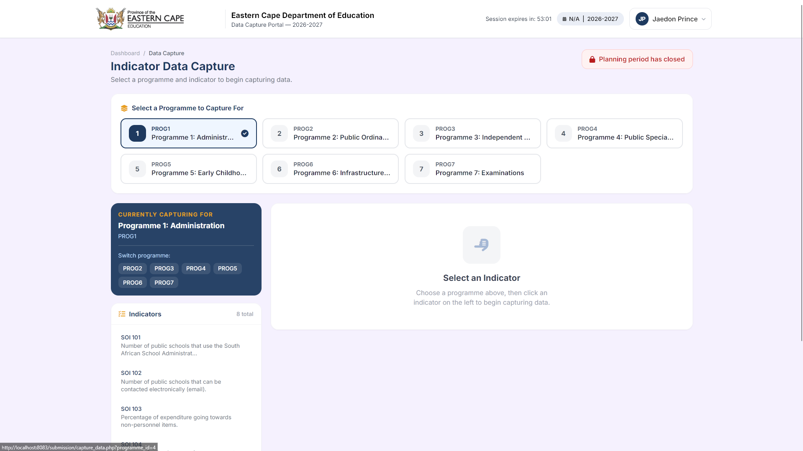
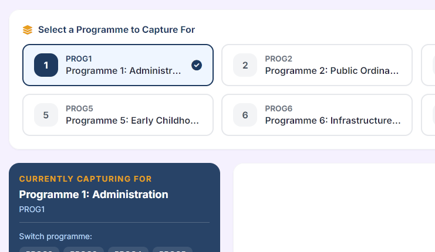
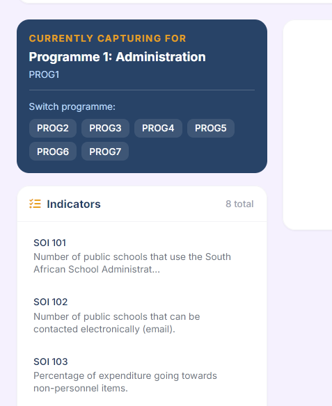
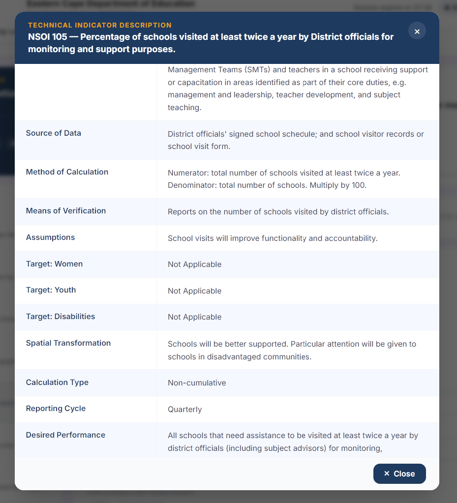
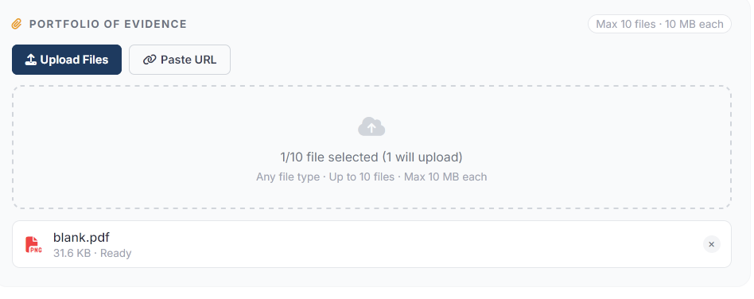

# Planning

As discussed in , this is the first page seen by a capturer.

{width="720"}

## Select your desired indicator

To continue with planning select a programme

{width="620"}

Then select the indicator to submit planning for.

{width="360"}

Once selected you will be able to see the details of the indicator, as well as a planning form.

> Notice the 5 tabs `Planning`, `Budget`, `Actuals`, `Challenges` and `POE & Submit`.
> Each tab following planning is for quarterly reporting.
>
{style="tip"}

{width="620"}

To view the [Technical Indicator Description](#select-your-desired-indicator), click on the **i** icon above the indicator's description.

{width="620"}

Use the Technical Indicator description to ensure that data submitted aligns with the constraints.

---

## Input Planning Data

{width="720"}

The fields on the planning form are as follows.

1. **Performance Targets**
    - <shortcut>Annual Planned Target</shortcut> Specify the annual target.
    - <shortcut>Quarterly Planned Targets</shortcut> Specify the targets for all quarters. (Q1, Q2, Q3, Q4)
2. **Funding Status** 
    - <shortcut>Funded / Non-Funded </shortcut> (click on the button to switch between Funded & Non-Funded.)
    - <shortcut>Allocated Budget</shortcut> Specify the budget available for this indicator (only appears when the status is set to Funded)
   
 {width="720"}

3. <shortcut>Key Activities Towards Achievement</shortcut> 
   Describe the key activities planned.
   
{width="720"}

4. <shortcut>Portfolio of Evidence</shortcut>
   Upload all evidence related to your plans. (you may upload files directly or paste a link to a cloud file)

---

Once all the required information is filled in click [Submit Planning](https://localhost){as="button"} at the bottom of the form.
