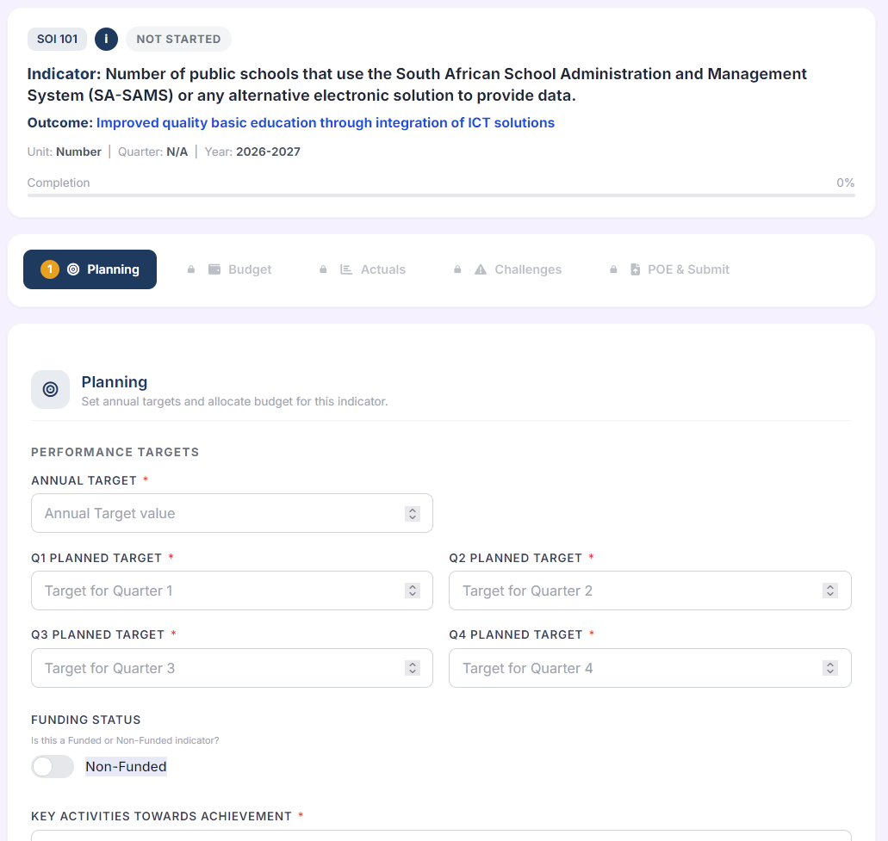

# Planning

As outlined in [Understanding Your Role](Understanding-Your-Role.md), the planning module is the primary workspace for a Data Capturer.

{width="720"}

## Select an Indicator

To begin the planning process, select a programme from the menu.

{width="420"}

Next, select the specific indicator for which planning data is to be submitted.

{width="360"}

Once selected, the indicator details and the planning form are displayed.

> The indicator interface consists of five distinct tabs: **Planning**, **Budget**, **Actuals**, **Challenges**, and **POE & Submit**. The tabs following Planning are utilized exclusively during quarterly reporting cycles.
{style="tip"}

{width="620"}

To review the Technical Indicator Description (TID), click the information icon (**i**) positioned above the indicator description.

{width="620"}

Consult the Technical Indicator Description to ensure that submitted targets and proposed verification methods comply with required departmental standards.

---

## Enter Planning Data

{width="720"}

The planning form consists of the following sections:

1. **Performance Targets**
    - <shortcut>Annual Planned Target</shortcut>: Specify the cumulative target for the financial year.
    - <shortcut>Quarterly Planned Targets</shortcut>: Specify the milestone target for each quarter (Q1, Q2, Q3, and Q4).
2. **Funding Status**
    - <shortcut>Funded / Non-Funded</shortcut>: Toggle between **Funded** and **Non-Funded** to reflect the financial status.
    - <shortcut>Allocated Budget</shortcut>: Enter the budget allocated to this indicator in Rands (ZAR). This field is displayed only when the status is set to Funded.

{width="720"}

3. <shortcut>Key Activities Towards Achievement</shortcut> 
   Detail the planned strategic and operational activities intended to achieve the indicator targets.

{width="720"}

4. <shortcut>Portfolio of Evidence</shortcut>
   Upload all supporting documentation substantiating the planned targets. You may upload files directly or provide a link to departmental cloud storage.

---

Once all mandatory information has been provided, click [Submit Planning](https://localhost){as="button"} at the bottom of the form to submit the planning data for verification.
