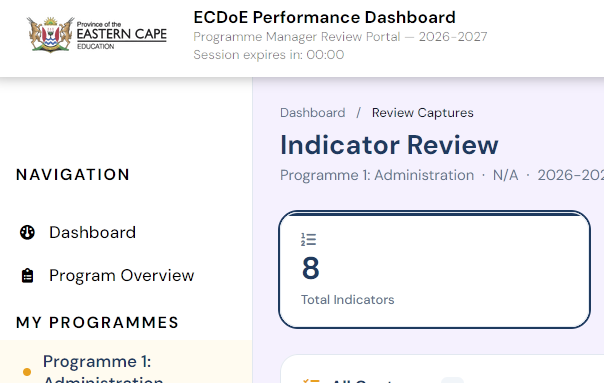
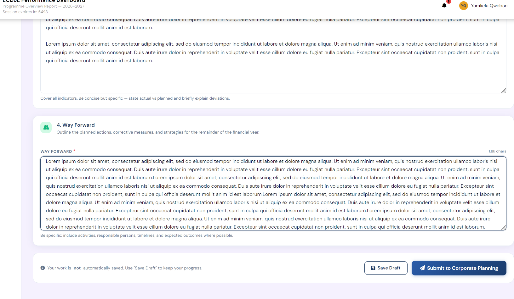

# Submit a Programme Overview

Once all indicators within a programme have been submitted, reviewed, and approved, the Programme Manager can compile and submit the consolidated **Programme Overview Report**.

## Navigate to the Report Module

To access the reporting module, select `Programme Overview` from the left navigation panel.

The system displays the **Programme Overview Report** interface.

{width="720"}

## Complete the Report

> The Programme Overview Report is a single-page form. Scroll down to view and complete all required sections.
> {width="380"}
{style="info"}

The left navigation panel lists all assigned programmes. To draft a report, select the relevant programme from this panel.

Once selected, complete the following sections:

1. <shortcut>Performance &amp; Challenges</shortcut>: Provide an evaluative narrative on current programme performance and the operational outlook for the remainder of the financial year.
2. **Budget and Expenditure**
    - **Budget Summary**: Review and verify the <shortcut>Total Programme Budget</shortcut>, <shortcut>Budget Allocated This Quarter</shortcut>, and <shortcut>Actual Expenditure</shortcut>.
    - <shortcut>Budget Commentary</shortcut>: Provide explanatory notes on budget utilization, underspending, or overspending.
3. <shortcut>Indicator Progress Notes</shortcut>: Provide specific commentary on the progress and variances of individual indicators within the programme.
4. <shortcut>Way Forward</shortcut>: Outline strategic plans, risk mitigations, and corrective actions to sustain or recover programme performance.

Once all sections are complete, click [Submit to Corporate Planning](0:0){as="button"} to submit the report for executive review.

> If you cannot complete the report in a single session, click [Save Draft](0:0){as="button"}. All entered information will be saved, allowing you to resume editing at a later time.
{style="info"}
