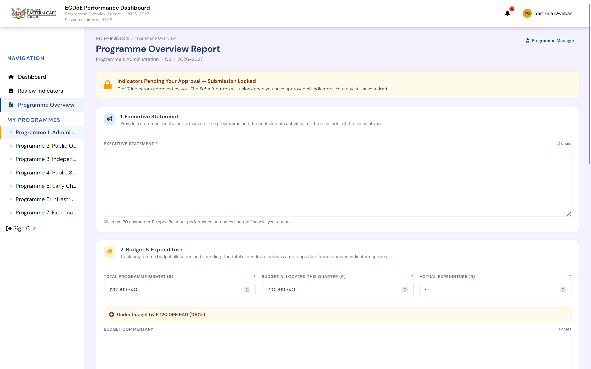

# Submit a Programme Overview

Once all indicators for a programme have been submitted, reviewed and approved, you will be able to submit a
`Programme Overview`.

## Navigate to the report module

To begin, select `Programme Overview` from the navigation panel.

A new page with the heading _"Programme Overview Report"_ will load.

{width="720"}

## Write your report

> The Programme Overview Report is a single page module, you can scroll to see all the fields.
> {width="380"}
> {style="info"}

A list of all your assigned programmes in the left navigation panel. To submit a report for a programme, select the
desired programme from the navigation panel.

Once selected, you must fill in the following information:

1. <shortcut>Challenges Encountered</shortcut> - Provide a statement on the current performance of the programme and its outlook for the remainder of the year.
2. Budget & Expenditure
    - Budget Summary: <shortcut>Total Programme Budget</shortcut>, <shortcut>Budget Allocated This Quarter</shortcut>,
      and <shortcut>Actual Expenditure</shortcut>
    - <shortcut>Budget Commentary</shortcut>  
3. <shortcut>Indicator Progress Notes</shortcut> - Provide commentary on the progress of individual indicators.
4. <shortcut>Way forward</shortcut> - Discuss plans, challenges and mitigations for maintaining or recovering progress for indicators and the programme.

Finally, once all information is complete, click [Submit to Corporate Planning](0:0){as="button"}

>If you are not yet finished and would like to return later to complete the report, click
> [Save Draft](0:0){as="button"}
>All information added will be saved for you to continue editing later.
>{style="info"}