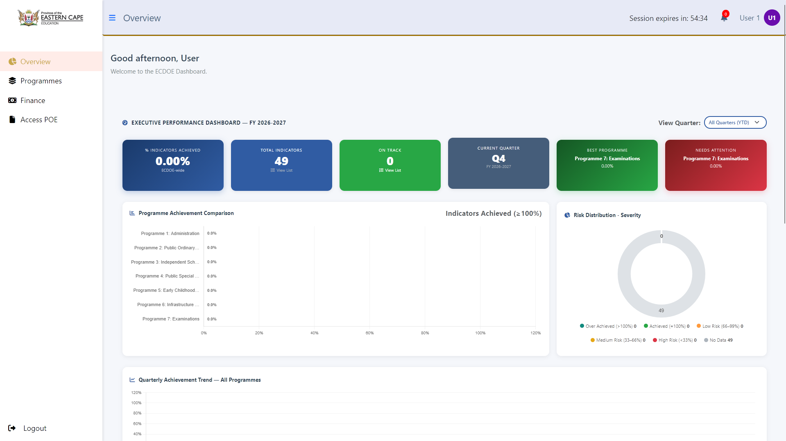
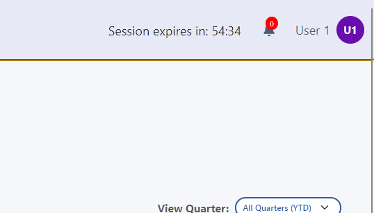

# Limited Session Time

The Programme Performance Monitoring System (PPMS) processes sensitive departmental performance data. To maintain system security and prevent unauthorized access, automated session management controls are strictly enforced.

## 1-Hour Session Limit

Upon successful authentication, you are directed to the landing page corresponding to your assigned [role](Understanding-Your-Role.md).

{width="720"}

A session countdown timer is visible in the top navigation bar.

{width="320"}

When this timer reaches 00:00, the session expires and the system automatically redirects to the login screen. You may sign in again to resume your work. This mechanism ensures that active sessions remain restricted to verified users.

## 10-Minute Inactivity Timeout

If the application detects 10 minutes of continuous inactivity (no interaction with the interface), your session terminates automatically, returning you to the login screen. This safeguard prevents unauthorized access at unattended workstations.
