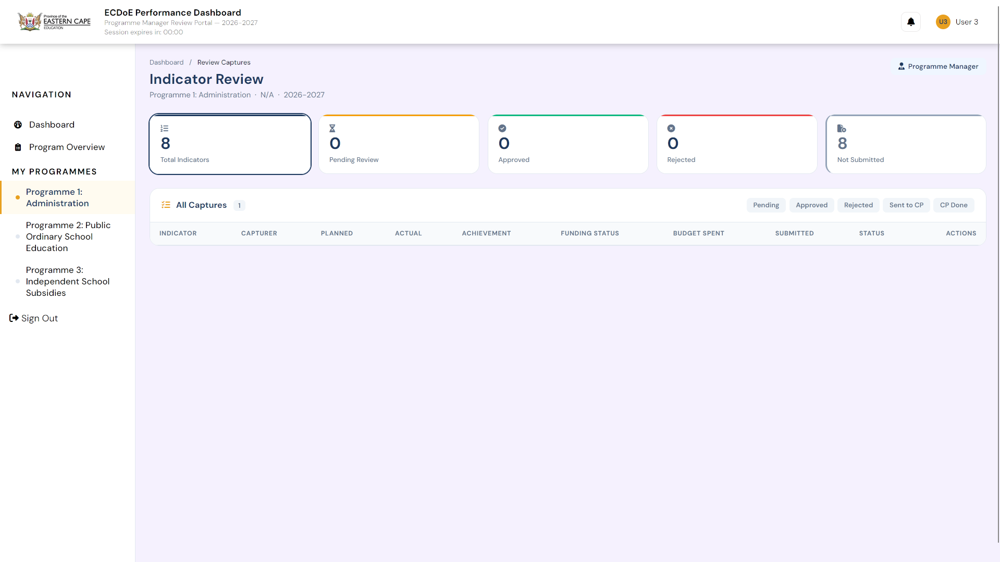

# Understanding Your Role

All PPMS Users are assigned a specific role. Each fulfills a different responsibility.

## Roles

### Senior Management

The `Senior Management` role is granted to users authorized to view the data and analytics of all pogrammes and
indicators.

### Auditor

The `Auditor` role shares the same viewing permissions as `Senior Management` for audit purposes.

### Data Capturer

A `Data Capturer` is granted access to the data capture module, where they submit yearly planning and quarterly
achievement data with evidence. A capturer will have specific programmes assigned to them.

### Programme Manager

A `Programme Manager` can review, edit and approve the capturers submissions, as well as submit a Programme Overview.

### Corporate Planning

A user with the `Corporate Planning` role has the ability to perform a second level review of the Programme.

### System Administrator

A user with the `SSystem Administrator` role handles user account management, permissions and reporting configurations.

