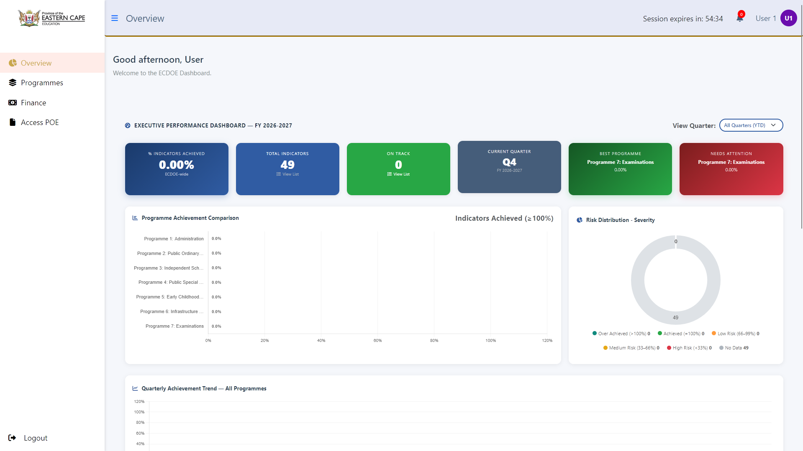
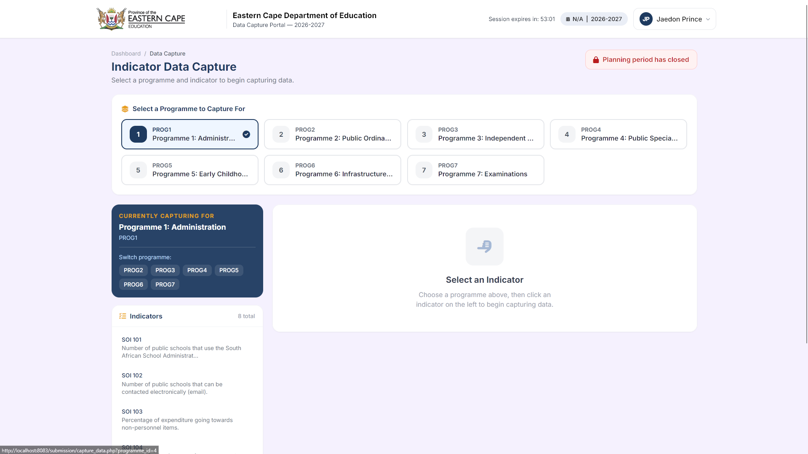
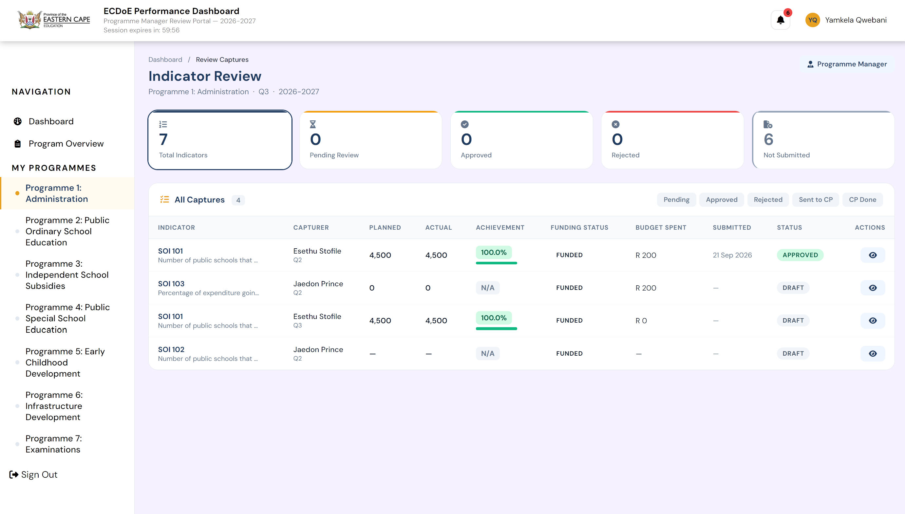
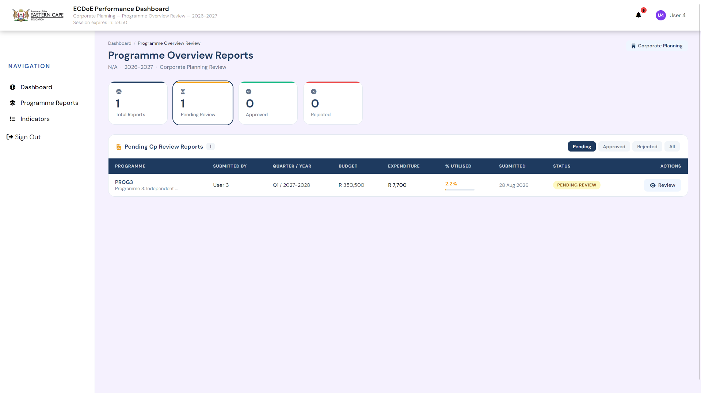
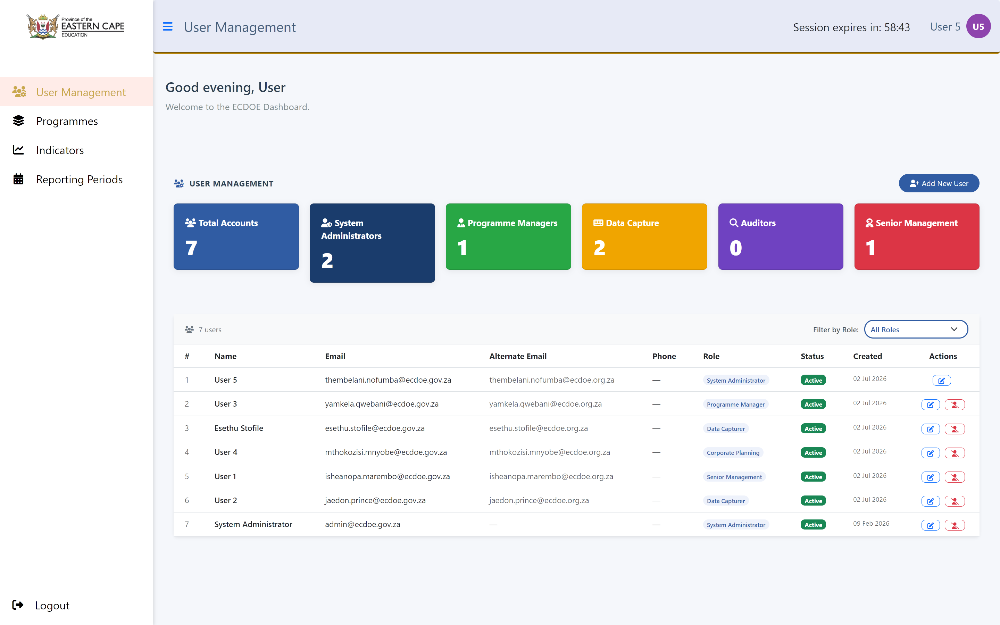

# Understanding Your Role

Each PPMS user is assigned a specific role that governs their system access, workflow permissions, and operational responsibilities.

## Roles

### Senior Management

Users assigned the **Senior Management** role have read-only access to performance data, reports, and analytics across all departmental programmes and indicators.

### Auditor

Users assigned the **Auditor** role hold comprehensive read-only viewing permissions equivalent to Senior Management to facilitate independent audit and compliance verifications.

### Data Capturer

Users assigned the **Data Capturer** role are granted access to the data capture module. They are responsible for submitting annual planning targets and quarterly performance achievement data, accompanied by supporting Portfolio of Evidence (POE) documentation for their assigned programmes.

### Programme Manager

Users assigned the **Programme Manager** role are responsible for reviewing, verifying, editing, and approving or rejecting submissions made by Data Capturers. In addition, Programme Managers compile and submit the consolidated Programme Overview report.

### Corporate Planning

Users assigned the **Corporate Planning** role conduct the second-level institutional review and approval of indicator submissions and Programme Overview reports across all departmental branches.

### System Administrator

Users assigned the **System Administrator** role manage user accounts, assign roles and permissions, configure reporting cycles, and maintain system-level parameters.
