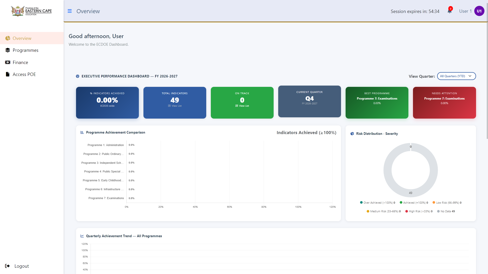

# Welcome

Welcome to the official User Guide for the Eastern Cape Department of Education (ECDoE) Programme Performance Monitoring System (PPMS).

{width="720"}

The PPMS platform facilitates and standardizes annual planning, quarterly performance reporting, and outcome indicator tracking across departmental programmes.
